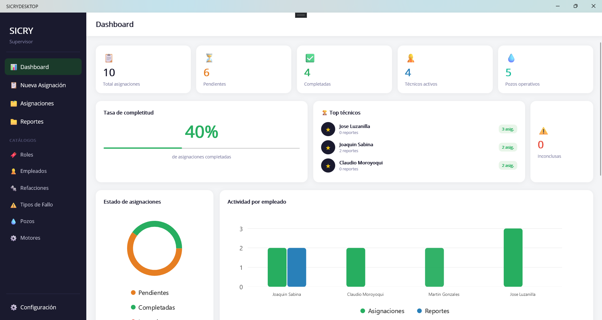
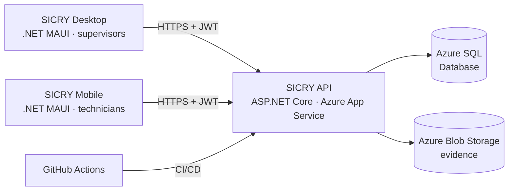
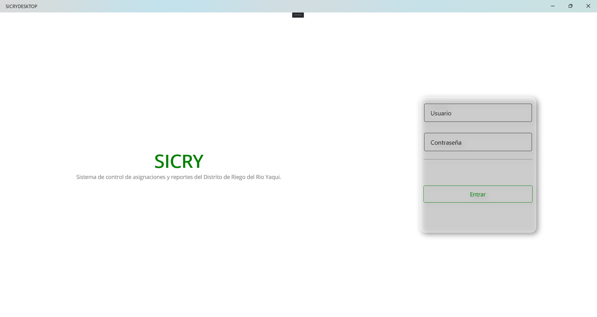
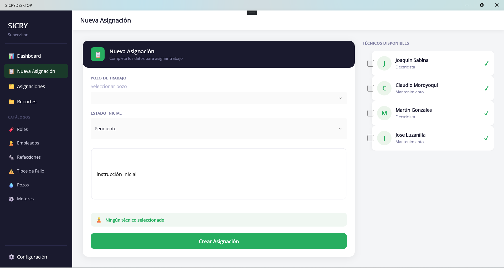

# SICRY — Industrial Maintenance Management System

**SICRY** (*Sistema de control de asignaciones y reportes*) digitizes the maintenance operations of the **Distrito de Riego del Río Yaqui** irrigation district. Supervisors assign work on wells and motors, field technicians report what they did with photo evidence, and everything is tracked in one cloud platform.

## What it does

- **Equipment tracking**: wells (*pozos*), motors and spare parts.
- **Work assignments**: supervisors create assignments for a well and pick the available technicians.
- **Technical reports** per trade: electrical, maintenance and motor rewinding.
- **Fault reporting** with fault categories and spare parts used.
- **Evidence**: photos and documents uploaded to the cloud.
- **Dashboard**: assignments by status, completion rate, top technicians and activity per employee.
- **Roles**: Supervisor, Electrician, Maintenance and Winder, each with its own permissions.

## Architecture

| Component | Technology | Repository |
|---|---|---|
| Backend API | ASP.NET Core Web API, EF Core, Mapster, JWT | [SICRY-Api](https://github.com/JuanMoroDev/SICRY-Api) (private) |
| Desktop client | .NET MAUI (Windows) for supervisors | [SICRYDESKTOP](https://github.com/JuanMoroDev/SICRYDESKTOP) (private) |
| Mobile client | .NET MAUI (Android / iOS) for field technicians | [SICRYMOBILE](https://github.com/JuanMoroDev/SICRYMOBILE) (private) |
| Database | Azure SQL Database | — |
| File storage | Azure Blob Storage | — |
| Hosting & CI/CD | Azure App Service + GitHub Actions | — |

The source code is kept in private repositories; this repository is the public overview of the system.

## Screenshots

| Login | New assignment |
|---|---|
|  |  |

## Author

**Juan Moroyoqui**: .NET developer focused on backend systems and cloud applications.
[GitHub](https://github.com/JuanMoroDev) · [LinkedIn](https://www.linkedin.com/in/juan-alfonso-moroyoqui-delgadillo-12b32b334/)
